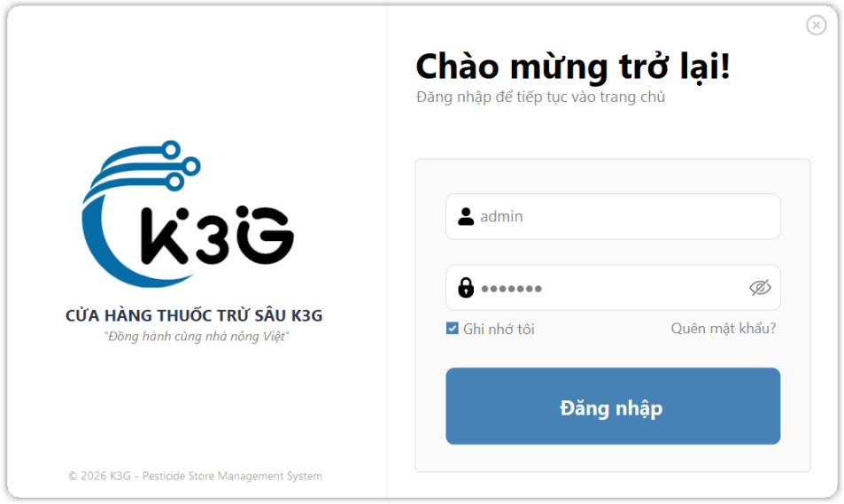
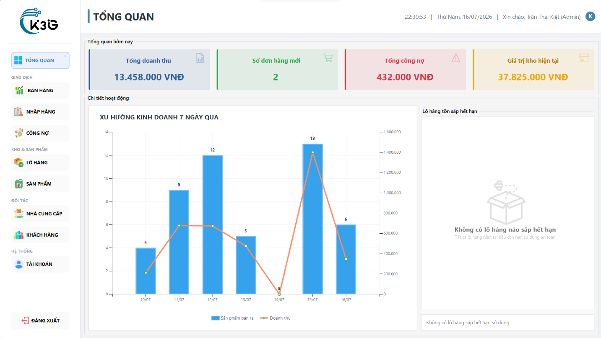
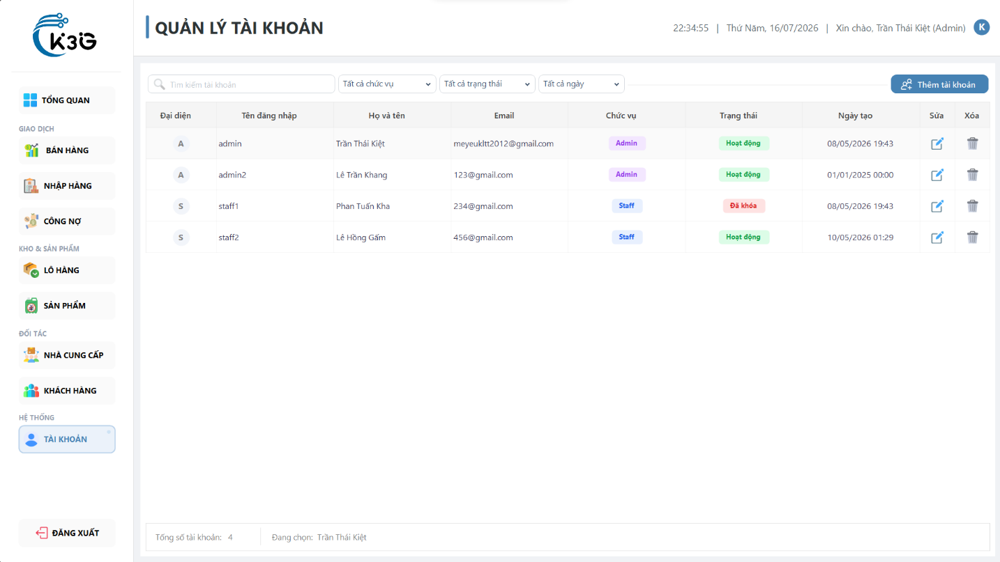
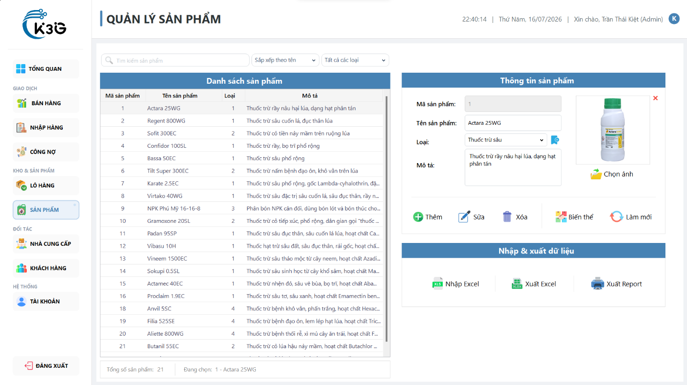
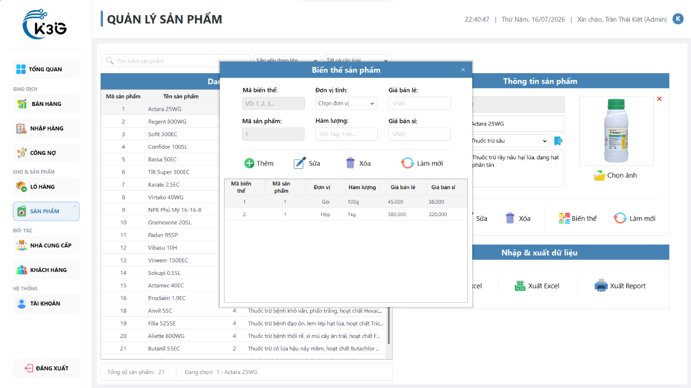
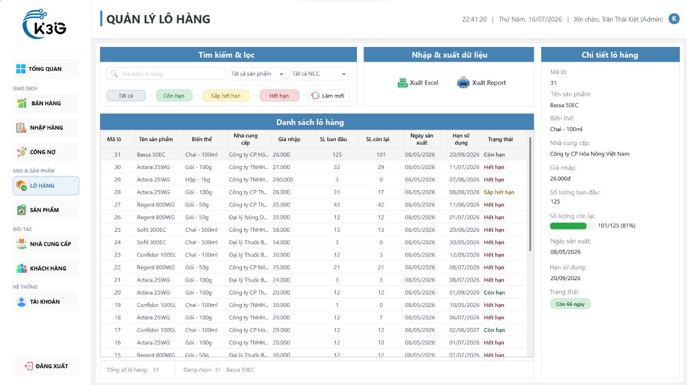
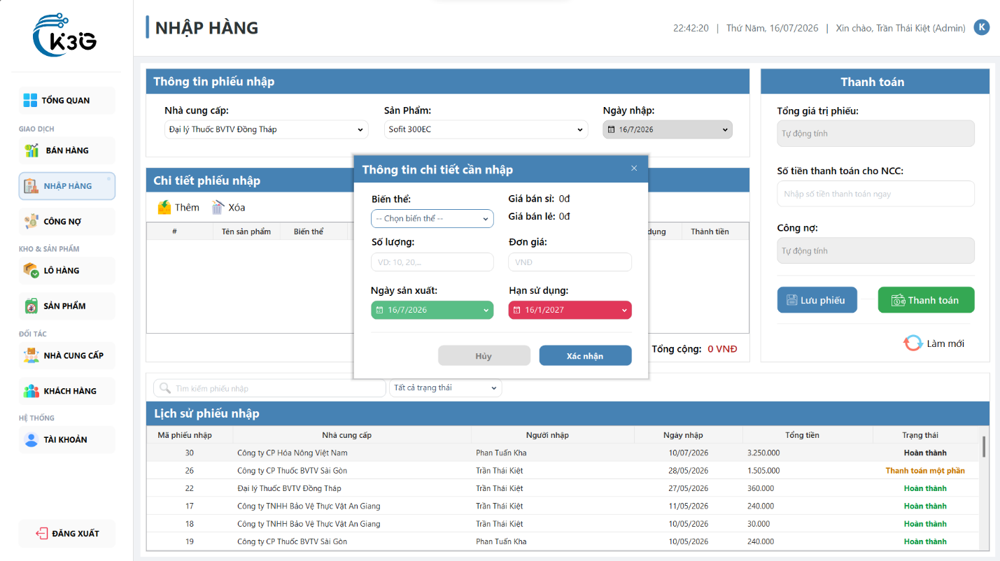
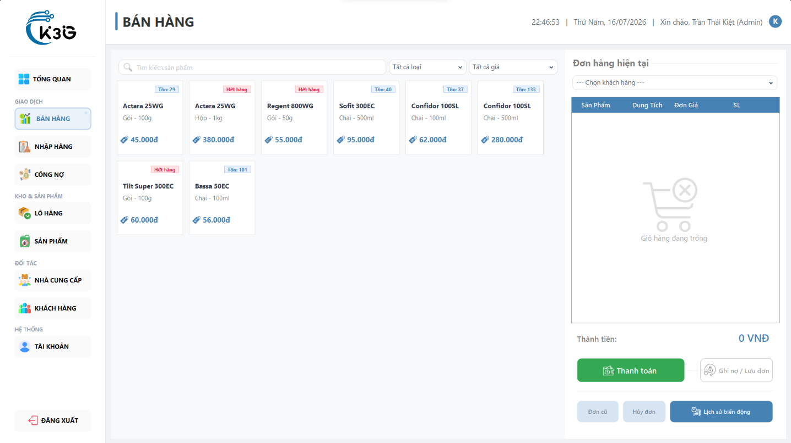
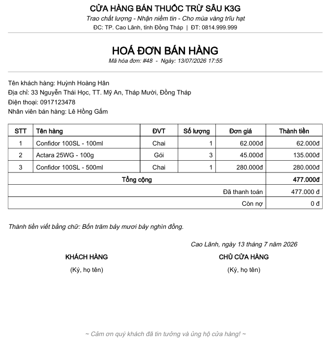
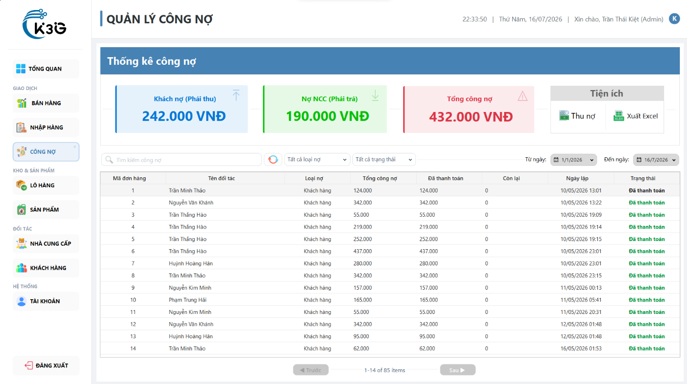

# 🌾 PESTICIDE STORE MANAGEMENT SYSTEM (QL_CuaHangBanThuocTruSau)

> **FINAL COURSE PROJECT - C# / .NET PROGRAMMING**

---

## 📌 PROJECT OVERVIEW

**Pesticide Store Management System** is a desktop application (Windows Forms Application) built with **C#** and the **.NET Framework**.

The project is designed to help agricultural supply and pesticide stores optimize sales and purchasing workflows, manage batches and expiration dates, track customer and supplier debts, and provide clear statistical reports for store owners.

---

## 👥 TEAM MEMBERS

| No. | Name               | Role            | Main Responsibilities                                                                               |
| :-: | :----------------- | :-------------- | :-------------------------------------------------------------------------------------------------- |
|  1  | **Lê Trần Khang**  | **Team Leader** | General management, system architecture design, account management module, and Dashboard statistics |
|  2  | **Lê Hồng Gấm**    | Member          | Sales and customer management modules                                                               |
|  3  | **Phan Tuấn Kha**  | Member          | Inventory, batch management, supplier purchasing, and debt management modules                       |
|  4  | **Trần Thái Kiệt** | Member          | Product, product variant, and batch management modules, plus interface integration                  |

---

## ✨ KEY FEATURES

### 1. 🔑 System & Accounts

- **Login & Access Control**: Provides access permissions for managers and sales staff.
- **Security & OTP Verification**: Supports password recovery through verification codes sent automatically to the user's email.
- **User Management**: Add, edit, lock, and unlock employee accounts.

### 2. 📦 Product & Batch Management

- **Category Management**: Classifies pesticides, fertilizers, and agricultural supplies.
- **Product Variant Management**: Manages packaging types (bottles, bags, buckets, boxes, etc.), units, and corresponding selling prices.
- **Batch Management**: Tracks batch numbers, manufacturing dates, and expiration dates to warn about products nearing expiration.

### 3. 🛒 Sales Management (POS)

- Quickly creates sales invoices and supports smart product search.
- Automatically deducts inventory from the correct batches (FIFO - first-expiring batch, first out).
- Prints sales invoices and stores detailed transaction history.

### 4. 🚚 Purchasing & Supplier Management

- Manages supplier information (name, phone number, address, and debt).
- Creates receiving notes and manages batch information for incoming inventory.
- Tracks detailed inventory receiving history.

### 5. 💳 Debt Management

- **Customer Debt**: Tracks debts, payments, and debt transaction history for customers.
- **Supplier Debt**: Manages outstanding amounts owed to suppliers.

### 6. 📊 Dashboard & Statistics

- Visualizes revenue, profit, and order quantities by day, month, or year.
- Alerts users about low-stock products and batches nearing expiration.

---

## 📸 SYSTEM DEMO & SCREENSHOTS

Below are actual screenshots demonstrating the core features and workflows of the application, captured from the system:

### 1. 🔑 Login & Access Control

> Secure authentication interface featuring role-based access control (Admin / Staff) and an automated password recovery workflow using OTP verification codes sent to the user's registered email.

---

### 2. 📊 Executive Dashboard & Analytics

> Centralized dashboard visualizing essential business metrics: total revenue, actual profit, order volume, financial trends, along with proactive real-time alerts for low-stock items and batches nearing their expiration dates.

---

### 3. 👥 User Account & Permission Management

> Employee account management module allowing administrators to create new staff accounts, assign roles (Admin / Staff), modify credentials, and safely lock or unlock user access.

---

### 4. 📦 Product & Catalog Management

> Centralized catalog management for pesticides, fertilizers, and agricultural supplies; supports product image uploads, category classification, and fast multi-criteria search filters.

---

### 5. 🏷️ Product Variant & Packaging Management

> Flexible packaging configuration for each product (bottles, bags, buckets, boxes), setting custom units of measurement and defining wholesale and retail pricing with strict business validation rules.

---

### 6. ⏳ Batch Tracking & Expiration Date Control

> Master-Detail interface designed for granular inventory tracking, displaying batch numbers, manufacturing dates, expiration dates, and lifecycle statuses (Valid, Expiring Soon, Expired) to streamline warehouse auditing.

---

### 7. 📥 Purchasing & Supplier Goods Receiving

> Purchase order workflow for incoming agricultural supplies: select supplier, specify variant quantities and purchase unit costs, register new batch metadata, and automatically update warehouse stock.

---

### 8. 🛒 Point of Sale (POS) & Checkout

> Core sales register interface for counter staff: rapid product lookup, real-time cart summary, automatic FIFO stock deduction (first-expiring batch, first out), discount calculations, and customer linking.

---

### 9. 🧾 Professional Sales Invoice Receipt

> Standardized printable receipt presenting full store details, customer contact information, itemized list of purchased items, subtotal, discounts, and payment methods.

---

### 10. 💳 Customer & Supplier Debt Management

> Financial control center featuring summary metric cards (Customer Receivables, Supplier Payables, Total Outstanding Debt), flexible debt settlement dialogs (full or partial payments), and standardized Excel export reports for accounting reconciliation.

---

## 🛠️ TECHNOLOGY & ARCHITECTURE

- **Programming Language**: C# (.NET Framework)
- **User Interface (GUI)**: Windows Forms (WinForms)
- **Database Management**: Microsoft SQL Server
- **ORM & Data Access**: Entity Framework (Code First / DbContext)
- **Architecture**: 3-Tier Architecture / Layered Pattern (Presentation - Business Logic (BUS) - Data Access (DAO/Context))
- **SMTP Email**: `System.Net.Mail` combined with Google SMTP Server for sending password recovery OTPs.

---

## 📁 PROJECT STRUCTURE

```text
QL_thuoctrusau/
├── docs/screenshots/     # Application screenshots and demo images
├── BUS/                   # Business Logic Layer (business processing)
├── DAO/                   # Data Access Object (database access)
├── Context/               # DbContext and Entity Framework configuration
├── Models/                # Entity classes (Product, Order, Customer, Batch,...)
├── ViewModels/            # Models supporting data presentation in the UI
├── Controllers/           # Controls the processing flow between Views and BUS
├── Views/                 # Windows Forms screens (Login, Sales, Inventory, ...)
├── Utils/                 # Shared utilities:
│   ├── EmailHelper.cs     # Sends verification OTP emails through SMTP
│   ├── ExcelHelper.cs     # Exports data reports to Excel files
│   ├── InvoicePrinter.cs  # Supports sales invoice printing
│   ├── Logger.cs          # Records system logs and handles exceptions
│   └── ReportHelper.cs    # Supports statistical report exports
├── Migrations/            # Entity Framework database version management
├── ImagesProducts/        # Product image directory
├── App.config             # Database connection string configuration
├── Program.cs             # Application entry point
└── QL_CuaHangBanThuocTruSau.sln # Visual Studio solution file
```

---

## 🚀 INSTALLATION & RUNNING GUIDE

### System Requirements:

- **Visual Studio 2019 / 2022** (with the _.NET desktop development_ workload installed).
- **Microsoft SQL Server** (version 2016 or later, or SQL Express) and **SSMS**.

### Steps:

1. **Clone / Download the project**:

   ```bash
   git clone <TEAM_REPOSITORY_URL>
   ```

2. **Open the project**:
   - Open `QL_CuaHangBanThuocTruSau.sln` in Visual Studio.

3. **Configure the database connection**:
   - Open `App.config`.
   - Update the `connectionString` to match your SQL Server:
     ```xml
     <connectionStrings>
       <add name="QL_ThuocTruSauDbContext"
            connectionString="Data Source=YOUR_SERVER_NAME;Initial Catalog=QL_ThuocTruSauDB;Integrated Security=True;TrustServerCertificate=True"
            providerName="System.Data.SqlClient" />
     </connectionStrings>
     ```

4. **Update the database (Entity Framework Migration)**:
   - Open the **Package Manager Console** in Visual Studio (`Tools -> NuGet Package Manager -> Package Manager Console`).
   - Run the database update command:
     ```powershell
     Update-Database
     ```

5. **Build & Run**:
   - Press `F5` or click `Start` in Visual Studio to launch the application.

---

## 📧 EMAIL VERIFICATION CONFIGURATION (EMAILHELPER)

For **password recovery / OTP verification by email** to work, configure the sending email account in `EmailHelper.cs`.

### 📂 File location:

[`QL_thuoctrusau/Utils/EmailHelper.cs`]

### ⚙️ Email configuration steps:

1. Open [`Utils/EmailHelper.cs`].
2. Change the values of the `FromEmail` and `AppPassword` constants:

```csharp
namespace QL_CuaHangBanThuocTruSau.Utils
{
    public static class EmailHelper
    {
        private const string Host = "smtp.gmail.com";
        private const int Port = 587;

      // 🟢 Replace with your Gmail sending address
      private const string FromEmail = "your-sending-email@gmail.com";

      // 🟢 Replace with the 16-character App Password generated by Google
        private const string AppPassword = "xxxx xxxx xxxx xxxx";

        // ...
    }
}
```

### 🔑 How to get a Gmail App Password:

1. Go to your Google account at [myaccount.google.com](https://myaccount.google.com/).
2. Select **Security** and make sure **2-Step Verification** is enabled.
3. Search for **App Passwords**.
4. Create a new app name (for example, `QL_ThuocTruSau`).
5. Google will generate a **16-character** password.
6. Copy the password and paste it into the `AppPassword` constant in `EmailHelper.cs`.

> ⚠️ **Important**: Do not use your regular personal Gmail password. You must use a Google **App Password** so email delivery is not blocked by Gmail security controls.

---

## 📝 LICENSE & ADDITIONAL INFORMATION

This project was developed as part of the **final project for the C# / .NET Programming course**. All information and source code are provided for educational and research purposes.
